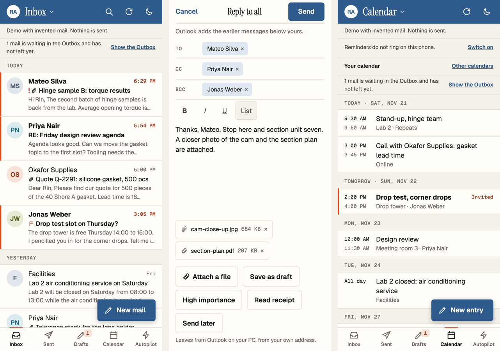
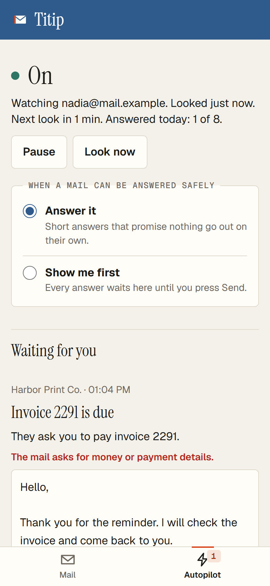

# Titip

Read, answer and write your Outlook mail from your phone. Your own PC serves it.
It can also answer the easy mail in your Gmail and keep the rest for you.

*Titip* is Indonesian for leaving something with someone to pass on. You leave a message with your PC,
and Outlook on that PC sends it exactly as if you had typed it at your desk.

**Try it with invented mail:** <https://juw12.github.io/titip/>



## What it does

- Shows Inbox, Sent and Drafts from the classic Outlook desktop app, newest first, including mail that
  rules or archivers moved into `.pst` data files. Unread mail carries a red dot.
- Opens a message with its formatting in a frame that cannot run scripts or load remote pictures,
  or as plain text. Attachments download to the phone.
- Reply, Reply all, Forward and new mail. Outlook adds the earlier thread. (No automatic signature: type it, or keep it in a draft.)
- Every send waits 5 seconds behind an **Undo** button. **Save as draft** puts it in Outlook's Drafts.
  If a send fails, the message comes back with your text and the reason.
- Search by subject or person. Light and dark. Works as a home-screen app.

It stores no password and writes no mail to disk. It drives the Outlook that is already signed in on
your PC. Once a phone has asked for mail, Titip keeps the first page of each folder and the messages on
it in its own memory, so a tap opens at once. Those copies are gone when Titip stops.
It keeps itself up to date (see [Updates](#updates)).

## Autopilot for Gmail

Titip can also look after a Gmail inbox on the same PC. It is off until you switch it on.



Every 10 minutes it looks at new mail in the Primary tab of the Gmail that Chrome is signed in to, and
for each mail does one of three things. All three are written down on the **Autopilot** page, live.

- **Answers it.** Only a short answer that promises nothing: thanks, "please send the details in
  writing", a simple question about your public work.
- **Keeps it for you.** Anything about money, a contract, a password or code, personal papers, or an
  answer that would name a date, a price, a link or an address. It waits under *Waiting for you* with
  a draft. You edit it and press Send, or press Don't answer.
- **Leaves it alone.** Newsletters, receipts, machines.

What it can never do is fixed in code, not in a prompt:

- answer anyone but the sender of the mail it just read
- send more than 8 answers a day per mailbox, or two to one conversation within 12 hours
- forward or delete mail, follow a link, open an attachment
- touch the mail that was already unread when you switched it on

Choose **Show me first** and nothing leaves without you. Your own answering rules go in
`autopilot_profile.md` in Titip's folder (`~/.titip`); without it a careful default is used.

How it works: Titip opens a narrow Chrome window at the edge of the screen, reads the mail through
Windows' accessibility interface and closes the window. It stores no Google password and uses no Google API.
The text of a mail is given to [OpenCode](https://opencode.ai) on your PC with every tool switched
off, so the model you run there reads it. If that model is a hosted one, the mail text goes to that host.

### Autopilot from any network

The Autopilot page can be opened from mobile data. For that the PC sends its state to a small relay
and takes your button presses from it. Both are encrypted on the PC and on the phone with a key that
only travels inside the QR code, after the `#` of the address, which a browser never sends to a
server. The relay holds ciphertext it cannot read.

You run the relay yourself, free, as a Cloudflare Worker:

```powershell
cd worker
npx wrangler kv namespace create RELAY      # put the id it prints into wrangler.toml
npx wrangler deploy                         # prints https://titip-relay.<you>.workers.dev
```

The relay keeps the Autopilot state in that KV namespace and passes mail through a Durable Object
(SQLite storage, which Cloudflare's free plan includes). `wrangler deploy` sets up both.

Put that address into `~/.titip/remote.json` as `{"relay": "https://titip-relay.<you>.workers.dev"}`,
start Titip again, and on the PC page press **Show a QR code** under *Pair a phone*. Scan it
once, on any network. **Make a new code** cuts off every phone that scanned the old one.

The PC reaches the relay the way its environment says (`HTTPS_PROXY`), then through the proxy Windows
is set to, then straight out, and remembers which one worked. So it keeps working when the PC moves
between an office and home, or when a local proxy program is not running.

## Mail from anywhere

With the relay in place, your Outlook mail can pass through it too: inbox, sent, drafts, reading,
attachments, writing, replying. It is **off** until you press **Switch on** next to *Outlook mail from
anywhere* on the PC page. From then on the code under *Pair a phone* opens the mail app itself, so
scanning it is all the pairing a phone needs: the phone can be on mobile data, and the PC on an office
network the phone could never join. A phone that scanned the code earlier gets a **Mail** tab on its
Autopilot page; the code is the same.

- The phone seals each question (show my inbox, open this mail, send this) with the key from the QR
  code. The PC picks it up, lets Outlook do it, and seals the answer. The relay passes both on and
  cannot read either. A question waits there at most 5 minutes, an answer is handed out once.
- A send is carried out once. A question the PC has seen before, one older than two minutes, or a
  send made before Titip last started is refused, so a mail cannot go out twice.
- It is slower than your own network. The PC looks for questions every 5 seconds while nobody reads
  mail and about once a second while somebody does, so the first tap can take a few seconds.
- An attachment over 1 MB is not sent through the relay. A very long formatted mail arrives as plain text.
- Anyone holding the link the phone saved can read and send your mail while the switch is on. **Switch
  off** closes that at once; **Make a new code** cuts off every phone.

Autopilot does not touch Outlook mail. It only ever answers Gmail.

### On the iPhone Home Screen

An iPhone gives a Home Screen icon its own storage. The key the browser kept after the scan is not
in it, so an icon made from the mail app used to open with nothing. The key now travels in the one
thing the icon keeps: the address of the page it was made from.

1. On the PC page press **Show a QR code** and scan it with the iPhone camera.
2. The page that opens says what to tap: **Share**, **Add to Home Screen**, **Add**.
3. Open Titip from the new icon. Mail, Sent, Drafts, writing, answering and Autopilot are all there,
   on any network.

- While that page waits for you, its address holds the key, for at most five minutes. Do not copy or
  share the address in that time. After five minutes, or when you leave the page, the key is taken
  out again. **Not now** skips the icon and opens Titip in the browser.
- The icon carries the key for as long as it exists. Whoever holds the unlocked phone can open it.
  **Unlink this icon** on its Autopilot page stops it; delete the icon afterwards. **Make a new
  code** on the PC cuts off every icon and phone.
- An icon made before version 0.5.1, or from any other Titip page, has no key. It says so when you
  open it. Delete it and scan the code again.
- Later, the Autopilot page in the iPhone browser has **Put Titip on the Home Screen** at the bottom.
- Android needs none of this: an icon there shares the browser's storage.

## Updates

A copy installed with `git clone` keeps itself up to date. A minute after it starts, then every 15
minutes, it looks at the published version. When there is a newer one it checks that the new version
starts on this PC, moves to it (a plain fast-forward), waits until nothing is in progress and starts
again. If the new version does not come up within 90 seconds, Titip goes back to the one before and
does not try that version again.

A copy on another branch, or with changes of its own, is left alone. The PC page shows the version,
the last look and a switch under *Updates*. If GitHub is only reachable through a proxy, put it in
`~/.titip/update.json`: `{"on": true, "proxy": "http://localhost:3128"}`. Each restart is noted in
`~/.titip/update.log`. The relay is not updated this way: run `npx wrangler deploy` again when
`worker/` changes.

Titip and everything it starts (git, the trial start, the new version) run at normal priority, even
when a tool on the PC has put Titip itself down to a lower one. Windows passes a lowered priority on
to whatever a program starts, and on a busy PC a new version started that way would not come up in
time.

## What you need

- Windows with classic Outlook (the desktop app, not "new Outlook") open and signed in
- Python 3.10 or newer
- The phone on the same network as the PC, or [Tailscale](https://tailscale.com) on both, or your
  own relay (see [Mail from anywhere](#mail-from-anywhere)) and then any network will do
- For Autopilot: Google Chrome signed in to Gmail, and [OpenCode](https://opencode.ai) with a model

## Start

```powershell
git clone https://github.com/juw12/titip
cd titip
pip install -r requirements.txt
python -m titip
```

A page opens on the PC. Press **Show a same-Wi-Fi code** and scan it with the phone's camera.
(With a relay set up, **Show a QR code** at the top gives a code that works on any network instead.)

The first time, the phone warns that the connection is not private. That is expected: the PC made its
own certificate, so the link is encrypted but no authority vouches for it. Tap *Advanced*, then
*Proceed* (Safari: *Show Details*, then *visit this website*).

`scripts/install.ps1` adds a Desktop shortcut and starts Titip quietly when you sign in to Windows.
`scripts/install.ps1 -Remove` takes both away.

| Command | What it does |
| --- | --- |
| `python -m titip` | Serve your Outlook mail to paired phones |
| `python -m titip --demo` | Invented mail instead of Outlook, safe to show around |
| `python -m titip unpair` | Cut every paired phone off |
| `python -m titip --http` | No encryption on the phone link. Only for a network you trust. |

## How the phone is trusted

- The same-Wi-Fi QR code holds a random code that works once, for five minutes. It sits in the part
  of the link that browsers never send to a server or write to a log.
- The QR code for any network is another kind: it does not expire, and it carries the key that seals
  everything the phone and the PC say to each other through the relay. It also sits after the `#`,
  and the phone takes it out of the address bar once it has kept it. Treat a picture of that code like
  a password. **Make a new code** makes the old one worthless.
- The phone trades it for a random device cookie (HttpOnly, SameSite=Strict, Secure). The PC keeps only
  a hash of it in `~/.titip/devices.json`.
- A phone without that cookie gets one page: "scan the QR code". No mail, no subject, no count.
- **Unpair all phones** on the PC page, or `python -m titip unpair`, cuts every phone off at once.
- The PC page that shows the QR code answers only on `127.0.0.1`.
- Your Outlook mail does not go through another server unless you switch on *Mail from anywhere*.
  Then it passes your own relay, encrypted, and the relay cannot read it. *Autopilot from any network*
  does the same for Gmail. There is no account and no analytics.

## Before you use it with work mail

Titip opens a door from your network to your mailbox. Read this first.

- Anyone holding a paired, unlocked phone can read and send your mail. Keep a screen lock on the phone.
- Check your employer's rules. Many companies do not allow mail on personal devices or extra services
  on a work PC, and *Mail from anywhere* carries mail off the company network, sealed, through a relay
  you run. That call is yours and theirs, not this tool's.
- Windows Firewall may block the phone. If the phone cannot connect, allow Python on port 47779 for
  your private or domain network. That needs an administrator.
- The PC must be on, awake and running Outlook. Titip is a window onto that Outlook, not a mail server.
  If a tool on the PC lowers the priority of background programs, Titip puts itself back to normal
  (never higher), so the phone still gets an answer while the PC is busy.
- Outlook answers one program at a time, and a full PC can keep any program waiting. So Titip reads
  ahead once a phone has asked for mail: the newest 40 messages of the Inbox, 20 of Sent and 10 drafts,
  and whatever an older page or a search showed the phone. Those open at once whatever Outlook is
  doing. When Outlook is busy the list is shown from memory with a note that says from when, and is
  replaced as soon as Outlook answers.
- After the phone is put down, Titip goes on looking for new mail every five minutes for eight hours,
  so what arrived in the meantime is already there when the phone is picked up again. It stops the
  first time it finds Outlook closed, and never opens Outlook for a phone nobody holds.
- While Outlook answers Titip its own window waits. Counting the folders is the slowest question when
  mail is kept in several data files, so the counts on the PC page and the drafts number on the phone
  are asked for at most every five minutes, and right after a send or a saved draft. The first
  question after Titip starts looks through every data file once, which can take a minute or two on
  a busy PC.
- A message Titip has not read yet still needs Outlook. The phone shows how it starts (the list knows
  the first lines) and keeps asking for up to five minutes. The question waits in Outlook's queue
  once, however often the phone asks. Only reading is asked again. A send is never repeated.
- A rule or tool that moves new mail into a data file changes the message's id. Titip finds the same
  message again by time, subject and sender, so it still opens and can be answered.
- If you run a tool that slows background programs (for example
  [CPU Eco Toggle](https://github.com/juw12/cpu-eco-toggle)), exempt Titip there. Titip restores its
  own priority, but a program that is not given the processor cannot even do that quickly.

## Limits

- Classic Outlook on Windows only.
- No attachments on mail you write from the phone (Forward keeps the original ones).
- Text you type is sent as plain paragraphs. A draft sent unchanged keeps its formatting; a draft you
  edit on the phone goes as plain text.
- Search looks at subject and sender (recipient in Sent), not the message body.
- Calendar invitations can be read, not accepted.
- Opening a message on the phone clears its red dot on that phone only. Outlook still shows it as unread.
- iPhone: Safari can forget the key of a page you have not opened for a week. A Home Screen icon
  does not, which is one more reason to make one. Web apps in the Mac Dock are not covered.

### Autopilot

- Windows and Chrome only. The PC must be on, unlocked and signed in to Gmail in Chrome's first profile.
- English Gmail. It finds Reply, Send and Mark as unread by their names.
- It reads the Primary tab only, at most 3 new mails per look, and nothing older than 2 days.
- A narrow Chrome window appears at the screen edge for a few seconds per look. Now and then it takes
  the keyboard for a moment and gives it back.
- Through the relay, an Autopilot button you press reaches the PC within about a minute.
- The model can misjudge a mail. The rules above hold whatever it says, and Show me first removes the risk.

## Develop

```powershell
python -m unittest discover -s tests -t .     # unit and server tests, no Outlook needed (the relay tests need Node)
python scripts/e2e.py                         # real browser against the demo mailbox (needs playwright)
python scripts/sync_docs.py                   # copy titip/web into docs/ for the public demo
```

The pairing code is adapted from [Cairn](https://github.com/juw12/cairn) by the same author.

MIT License.
